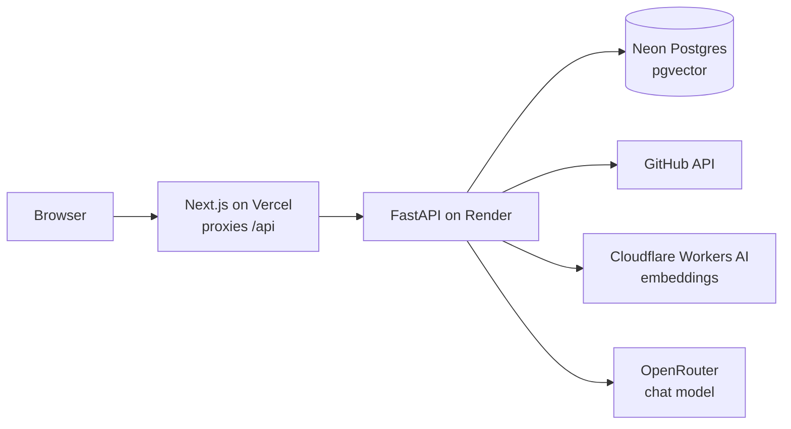

# Codebase Intelligence Platform

Connect a public GitHub repository, index one pinned commit, and then explore it: browse files, search by meaning, see a dependency graph, check what a change would affect, and ask questions that are answered with file and line citations that were checked against the code.

It runs on free tiers (Vercel, Render, Neon) with no always-on worker, and it is built to say "I cannot determine this" rather than guess.



## What it does

| Tab | What you get |
| --- | --- |
| Overview | Indexing progress (fetch, parse, embed, graph), counts, and Re-index and Disconnect |
| Files | File tree and a Monaco viewer; secrets found in source are redacted before storage |
| Search | Meaning-based search over code chunks, with jump to the lines |
| Graph | Files and symbols as a graph. An edge is drawn solid only when the code proves it; everything else is dashed and labelled with why it is unresolved. Selecting a node opens the impact panel: who depends on it, with the path to each, suggested tests, and an optional AI review kept apart from the proven results |
| Ask | Questions answered with numbered citations. Each cited statement must quote the code word for word, or it is dropped |

Languages: Python, JavaScript, TypeScript and Go, plus README files. Public repositories work out of the box. Private repositories (GitHub App installed on them) are supported with **your own** embedding and chat providers and keys: their code is never sent to this app's providers. That part is newer and has been tested against fakes, not yet against real provider keys; see `docs/PLAN.md` (M9).

## Run it locally

You need Docker, Python 3.13 with [uv](https://docs.astral.sh/uv/), and Node 22.

```bash
docker compose up -d db                      # Postgres with pgvector
cp .env.example .env                         # then fill it in; see below
cd backend && uv sync && uv run alembic upgrade head
uv run uvicorn app.main:app --port 8000      # terminal 1
cd ../frontend && npm ci && npm run dev      # terminal 2
```

Open http://localhost:3000. Signing in needs a GitHub App ([setup, about 10 minutes](docs/GITHUB_APP_SETUP.md)). Search needs Cloudflare Workers AI credentials and Ask needs an OpenRouter key; `.env.example` explains each value. Restart the backend after editing `.env`.

For a first look without those keys, set `EMBEDDING_PROVIDER=hash` (an offline, word-matching stand-in: it works, but it is not semantic).

## Tests

```bash
cd backend && REQUIRE_DB=1 uv run pytest      # 1,458 tests, needs the database
cd frontend && npm test                       # 239 tests
```

CI (`.github/workflows/ci.yml`) runs lint, types, tests and a build for both. Tests use fakes for GitHub, the embedding service and the chat model, so they need no keys.

## Measured results

Every number below was produced by a script in `backend/eval/` and the full reports are in `backend/eval/results/`. The datasets are small, and that matters.

**Retrieval** (Cloudflare `bge-small-en-v1.5`; MRR, higher is better):

| Method | psf/requests, 40 questions | pallets/click, 20 questions, held out |
| --- | --- | --- |
| keyword | 0.577 | 0.462 |
| vector (the default) | 0.826 | 0.571 |
| hybrid | 0.721 | 0.505 |

Hybrid never beat vector search, so vector is the default. The click intervals are wide (0.38 to 0.78 for vector), so the evidence is the consistent direction across both sets, not either number alone.

**Graph precision**: static call edges were checked by reading call sites next to definitions: click 40 of 40, ky 20 of 20, mux 20 of 20, requests 12 of 12, express 18 of 20 before a bug was fixed (then all 56 remaining were read and correct). Recall is low by design: static calls were 29% of call sites in requests, 30% in click and 3% in express, because method calls on variables cannot be resolved without types.

**Questions**: on the 7 real-model answers checked (psf/requests), every answer cited the code it was expected to, 21 statements were kept and 2 were dropped by the validator. 14 of 14 unanswerable questions that reached the model were declined. These samples are small and answer correctness was not graded. See `docs/PLAN.md` (M7) for what is and is not shown.

## How it is built

- **Indexing with or without a worker.** A resumable job state machine (fetch, parse, embed, graph) advances one bounded step at a time. On the free tier the open browser tab drives it through `tick` requests; an optional background worker (`python -m app.worker`) runs the same step with no tab open. A restart loses at most one step.
- **Static graph you can trust.** Imports and calls are resolved only when the code proves them; unresolved ones are stored with a reason and never used as facts.
- **Answers that are checked.** The model returns claims with a verbatim quote; a validator confirms each quote exists in the excerpt it cites. Retrieved code is wrapped in a per-request random delimiter and treated as data, not instructions.
- **Safe by default.** No repository code is ever executed; detected secrets are replaced before anything is stored; every route checks ownership; limits apply per user.

More: [architecture, schema, API and security model](docs/ARCHITECTURE.md) · [threat model and open security risks](docs/THREAT_MODEL.md) · [plan, results and known limitations](docs/PLAN.md) · [deployment](docs/DEPLOYMENT.md) · [demo script](docs/DEMO.md). The API's interactive reference is served at `/docs` on the backend.

## Known limits

- Free models are slow, rate limited and sometimes empty: Ask takes 10 to 30 seconds and can fail with a retryable error.
- A fluent answer is possible when search misses the right code; the quotes in it are real, but may not be relevant. A citation proves the quote is in the cited lines, not that the claim follows from it.
- One API instance (the rate limiter is in-process). Private repositories and scale-out are planned (M9, M10), not built.
