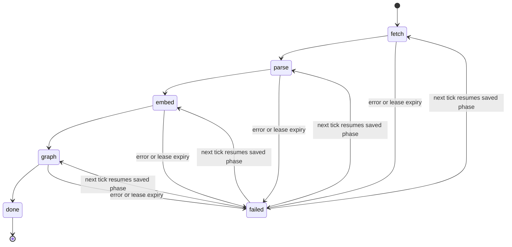
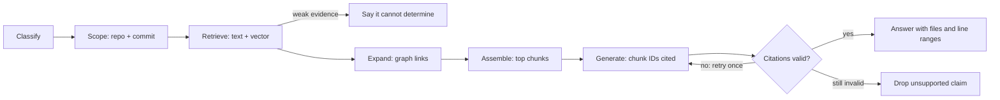
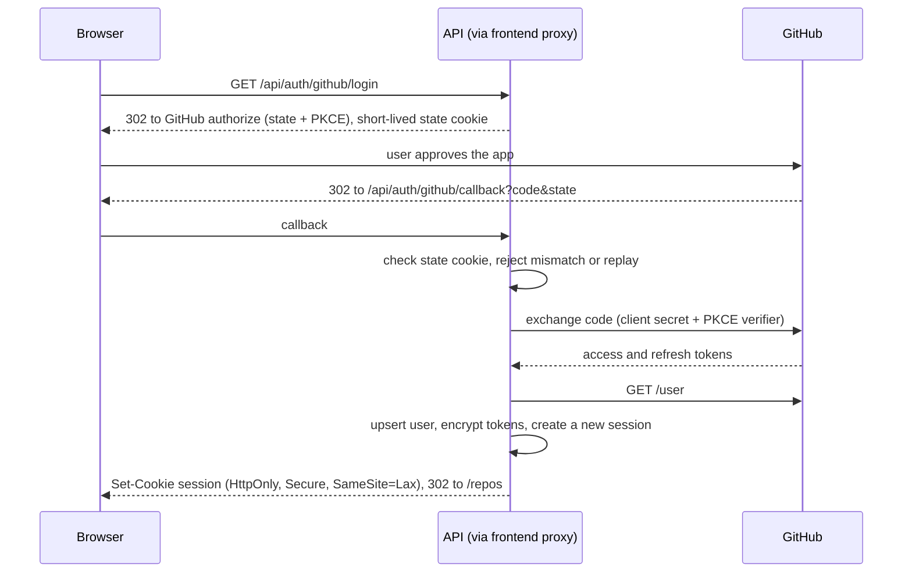
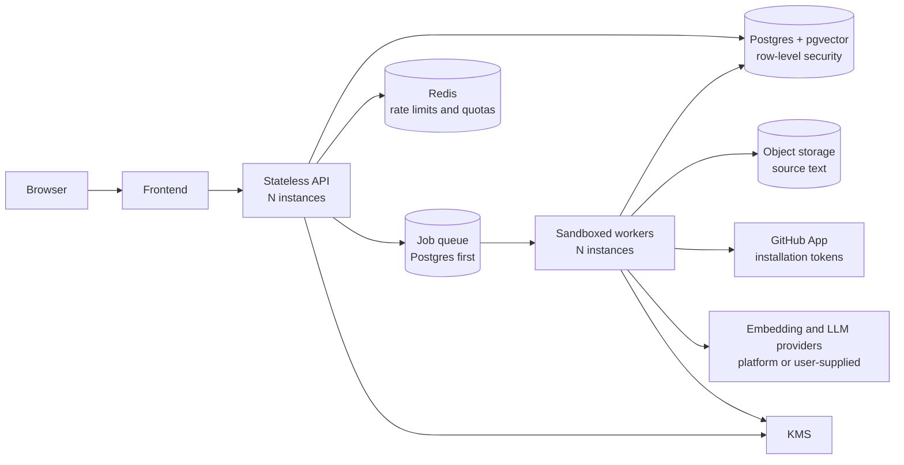

# Architecture

The API keeps no state between requests. The browser, or an optional cron, calls `tick`; each tick does one bounded step, and every result is written to Postgres, so a sleeping Render instance loses nothing.

## System overview


Backend modules depend inward only: routes call services, services call repositories and providers, nothing imports routes.

## Indexing job lifecycle



Each tick claims the job with a compare-and-set on `lease_until` (an `UPDATE ... WHERE lease_until IS NULL OR lease_until <= now()`), runs one bounded step of the current phase inside a single transaction, and writes the new phase and cursor only if it still owns the lease. A crashed tick's lease expires and the next tick continues from the last committed state. Nothing a failed step wrote is kept.

**Failure handling.** Transient errors (GitHub unavailable, fetch timeout, unexpected exceptions) back off exponentially and the job fails after `MAX_ATTEMPTS` (3). Upstream GitHub rate limits wait until the reset time without using an attempt. Non-retryable errors (for example `repo_too_large`) fail immediately. While backing off, `lease_until` doubles as "do not retry before". A failed job keeps `failed_phase` in its cursor, and `POST /index` for the same commit restarts it there.

**Fetch phase.** Streams the tarball (never to disk) and stores source files for the supported languages. The redirect to `codeload.github.com` is followed manually and the token is never sent there. Limits, all configurable: 25 MB compressed, 150 MB uncompressed (declared member sizes), 60,000 entries, 256 KB per file, 2,000 kept files, 5 MB kept source, 40 s deadline. Skipped files are counted by reason (`unsupported`, `vendored`, `generated`, `binary`, `too_large`, `secret_file`, `unsafe_path`).

## Parsing and chunking (M4)

The `parse` phase turns each stored source file into symbols, references and chunks. It is resumable like every phase: files are handled in id order, each tick parses for at most 15 seconds, the last finished file id is kept in the job cursor, and a file's old rows are deleted before it is parsed again, so a restarted phase never duplicates anything.

**Extraction** uses Tree-sitter (Python, JavaScript with JSX, TypeScript and TSX, Go). The files are untrusted input: they are only parsed, never executed, parsing is time-limited, and every walk is iterative or depth-capped.

| Language | Symbols | Imports and calls |
| --- | --- | --- |
| Python | functions, methods, classes (decorators and leading comments included); definitions inside `if`/`try`/`with` blocks | `import`, `from ... import` (relative levels, aliases, `*`); calls with receiver |
| JavaScript and TypeScript | functions, classes, methods, arrow functions assigned to names, class fields holding functions, CommonJS `exports.x =` and `X.prototype.y =`; TypeScript interfaces, types, enums, namespaces | ES imports and re-exports, `require()`, dynamic `import()`, type-only imports; calls and `new` |
| Go | functions, methods (qualified by receiver), structs, interfaces, types | imports with alias, blank and dot forms; calls with receiver |

A symbol's line range includes its decorators or `export` keyword and the comment lines directly above it. Calls are de-duplicated per enclosing symbol with a count and are recorded by callee name and receiver only. Nothing is resolved to a target until the graph milestone, and dynamic calls are never guessed.

**Chunking** produces ranges of whole lines with these guarantees, all tested: every non-blank line of a file is in exactly one chunk; chunk text is the exact source lines; chunks start and end on code; and a chunk is at most 1,800 characters unless a single line is longer. A symbol becomes one chunk; one too big is split into its members (a class becomes a header chunk plus one chunk per method); a big symbol with no members is cut into windows at blank lines; code between symbols becomes its own chunks; and neighbouring tiny chunks are merged. Because a chunk is exactly the cited lines, a citation (path, start line, end line) points at the text that was embedded and shown to the model.

**Secret redaction** runs in the fetch step, before any text is stored, so a raw credential never reaches the database, the index, the API or a log. Matched values are replaced by `[REDACTED:<kind>]` placeholders on the same line (a private key block keeps its line count), so line numbers stay valid. Rules cover well-known token formats (cloud, source-host, chat, payment, AI-provider and JWT), passwords inside URLs, private key blocks, and quoted high-entropy values next to names like `password` or `api_key`. Generic matches require a random-looking value, so words, slugs, paths, URLs and placeholders are left alone. Findings record the kind and line, never the value. The parse phase redacts again for rows stored by older versions.

**Limits** (configurable): 6,000 chunks per snapshot (over the cap the job fails with `repo_too_large`), 20 files read per batch, 15 seconds of parsing per tick, 400,000 syntax nodes and 5,000 distinct calls per file.

## Embeddings and retrieval (M5)

**Embedding.** The `embed` phase runs after `parse`. Providers implement one `Embedder` protocol (`model_id`, `dim`, `batch_size`, `embed_documents`, `embed_query`): `CloudflareEmbedder` calls Workers AI `@cf/baai/bge-small-en-v1.5` (384 dimensions, CLS pooling, vectors L2-normalised, usage counted in neurons) and `HashEmbedder` is an offline, lexical, deterministic stand-in for tests. Each chunk is embedded as `File: <path>` plus its text. Queries get bge's retrieval instruction; documents do not. Like every phase it is resumable: chunks without a vector are embedded in batches for at most 20 seconds per tick (at least one batch), the cursor records `embedded`, `total`, `model` and `neurons`, and vectors from another model id are reset first, so two vector spaces are never mixed. Errors are typed: `embedding_not_configured` and `embedding_quota_exceeded` do not retry; `embedding_unavailable` does with backoff; `embedding_auth_failed` and `embedding_bad_response` surface as failures.

**Search** (`POST /api/repositories/{id}/search`, owner only, 20 per minute per user because each call embeds the query):
- *Keyword*: Postgres full-text (`simple` configuration) over a generated `tsv` column that indexes plain words and camelCase-split words, OR-matched and ranked by `ts_rank_cd`, plus a path match and a bonus when the chunk defines a symbol named in the query.
- *Vector*: exact cosine distance in pgvector, scoped to one snapshot. There is deliberately no ANN index; see the plan's deviations.
- *Hybrid*: reciprocal rank fusion (k=60) of both lists.
- The default is `vector`. If the snapshot has no embeddings yet or the embedding service fails, the response is keyword search with `warnings` explaining why; `mode_used` always says what actually ran.

**Evaluation** lives in `backend/eval` and is run by hand (it needs the network): labelled questions point at symbols, not line numbers, so labels survive re-chunking; it reports Recall@k, MRR, bootstrap intervals and paired comparisons, and its benchmark mode raises instead of falling back.

## Dependency graph and change impact (M6)

The `graph` phase runs after `embed` and finishes the job. It is a pure function of the snapshot (files, symbols, references): it deletes the snapshot's edges and writes them again, so a restarted phase is safe.

**Edges** (`graph_edges`): `imports` (file to file) and `calls` (symbol to symbol, or file to symbol for top-level code), each `static` or `unresolved`. An edge is `static` only when the code proves it: an import naming a file in this repository, or a call whose name is bound by such an import (including through re-exports, followed up to six hops), defined in the same module, reached through `self`/`this` inside the enclosing class, or declared in the same Go package. Anything that needs type information is `unresolved`, with `target_name` (what the code said) and a `reason`. The builder never matches by name alone across files, and a name defined twice, or both defined and imported, is ambiguous and left unresolved.

| Language | Import resolution |
| --- | --- |
| Python | absolute and relative imports against package roots; `from pkg import sub` may be a submodule; `__init__` re-exports are followed |
| JavaScript and TypeScript | relative specifiers with extensions, `index` files and the TypeScript `.js` for `.ts` convention; named, default, namespace, `require` and re-export bindings; bare specifiers and aliases are unresolved |
| Go | imports under `github.com/<owner>/<repo>` (from the repository URL) map to a directory's non-test files; the package name comes from the `package` clause |

JavaScript property assignments are recorded as symbols; `exports.x = ...` is importable but not a name in scope, and `obj.x = ...` is neither, so a bare `x()` never resolves to it.

**Impact** is a breadth-first walk over reversed static edges from the changed file or symbol, to a depth of at most six. Each dependent comes with the edge path from the change. A file's dependents use import edges plus file pairs joined by resolved calls (same-package Go); a symbol's dependents are its callers. Cycles are handled by visiting each node once at its shortest depth.

The response keeps three kinds of answer apart:
- `dependents`: static facts only.
- `suggested_tests`: test files that statically depend on the change (`static_dependency`, high confidence when direct), and test files named after a changed file (`naming_convention`, low confidence, `heuristic: true`).
- `unverified_callers`: unresolved calls whose last name segment equals a changed name. Matched by name only, shown as leads, never as dependents.

`limitations` is always returned.

**AI review** (`POST .../impact/review`) sends the static result and a code excerpt (the symbol's own lines, or a file's top-level declarations) to the language model between `<<<DATA`/`DATA>>>` markers, with a system prompt that says the data is never instructions. The answer is parsed against a schema and validated: every cited file must be one the analysis surfaced, suggested tests must exist and be test files, a risk can be `high` confidence only if it cites a proven dependent (otherwise capped at `medium`, or `low` if it cites nothing), and wrong shapes are dropped and counted. The database connection is released before the model call. The client has a 28 second whole-call budget, fallback included, because the browser reaches the API through a proxy that gives up after about 30 seconds. The result is returned in its own object, labelled unverified, never merged into `dependents`.

**Views.** `GET .../graph` returns the files linked by imports (and resolved calls), capped at the 60 most connected files for the whole repository and at 300 for a neighbourhood (`path` and `depth` up to 3); with `level=symbol&path=...` it returns one file's symbols with their static callers and callees, plus unresolved calls as dashed edges to nodes named after what the code said (at most 40).

## Chat workflow (LangGraph)



The model returns chunk IDs, never line numbers. The server maps IDs to path and line range and rejects any ID that was not retrieved.

## Authentication and ownership (M3)

Sign-in uses a GitHub App's user-authorization flow. The browser only ever talks to one origin: the frontend proxies `/api/*` to the API, so the session cookie is first-party and `SameSite=Lax` is enough.



**Sessions.** A random 256-bit session ID goes in the cookie; only its hash is stored. Sessions have an absolute and an idle expiry, a new ID is issued at login (no session fixation), and logout deletes the row.

**CSRF.** State-changing routes require an `Origin` that matches the configured frontend, in addition to `SameSite=Lax`.

**GitHub tokens.** The user's access and refresh tokens are encrypted at rest with an application key and used only on the server, never returned to the browser or logged. They are refreshed before they expire. If GitHub rejects a token (revoked or expired refresh), the API returns 401 `reauth_required` and the UI sends the user back through sign-in.

**Data collected.** GitHub numeric ID, login and avatar URL. No email address is requested.

**Ownership.** Repositories stay global, because a public repo and its snapshots are shared. What is per user is the link in `user_repositories`: a user lists, queries and ticks only repositories they connected. Anything else returns 404, not 403, so repository IDs cannot be probed. Quotas and the index rate limit key on the user; IP-based limits remain for the unauthenticated auth endpoints.

**Implementation notes.**
- The session cookie is `__Host-cip_session` when cookies are Secure (host-only, `Path=/`), and `cip_session` for plain-http local development.
- The login state lives in `cip_oauth_state` (`Path=/api/auth`, 10 minute lifetime). It is encrypted and authenticated with a key derived from `SESSION_SECRET`, so the browser cannot read the PKCE verifier or forge it, and it is cleared by every response from the callback. A replayed callback therefore fails.
- The `next` parameter is accepted only as a same-site relative path, on the server and again in the frontend.
- GitHub refresh tokens are single-use, so concurrent refreshes are serialized with a row lock. If a refresh fails or a stored token cannot be decrypted, the stored credentials are deleted and the user is asked to sign in again.
- If GitHub rejects a token that looks valid locally (revoked), the API returns 401 `reauth_required` and the UI offers a "Sign in again" link. Signing in again replaces the old session.
- Settings fail fast in production: GitHub App credentials, `SESSION_SECRET`, `TOKEN_ENCRYPTION_KEY`, Secure cookies, an https `APP_BASE_URL` and a non-default `CLIENT_KEY_SALT` are all required, and a rejected secret is never echoed in the startup error.

**Token use.** An index or tick request uses the calling user's GitHub token, so each user gets their own GitHub rate limit. The optional platform `GITHUB_TOKEN` is only a fallback.

## Database schema

File contents live in Postgres because Render's disk is ephemeral and a resumed job must not re-download the repo.

| Table | Key columns | Purpose |
| --- | --- | --- |
| `repositories` | id, owner, name, url, default_branch, created_at | One row per GitHub repo. Unique on (owner, name). |
| `snapshots` | id, repo_id, commit_sha, status, file_count, chunk_count, error, indexed_at | One per pinned commit. Unique on (repo_id, commit_sha), which blocks duplicate ingestion. |
| `index_jobs` | id, snapshot_id, phase, cursor (jsonb), lease_until, attempts, error | Resumable state machine. Phases: fetch, parse, embed, graph, done, failed. |
| `files` | id, snapshot_id, path, language, size_bytes, sha256, content, skipped_reason, redactions, parse_status | Source text, capped per file. Secrets redacted before insert; `redactions` counts them. `parse_status` is `ok`, `syntax_errors` or `truncated`. |
| `symbols` | id, snapshot_id, file_id, kind, name, qualified_name, start_line, end_line, parent_id, signature | Functions, methods, classes, interfaces, types, enums, structs, namespaces (M4). `qualified_name` is `path::Outer.name`; `parent_id` links a member to its class. |
| `code_refs` | id, snapshot_id, file_id, symbol_id, kind, name, line, detail (jsonb) | Imports and calls found in a file (M4), de-duplicated per enclosing symbol. The graph milestone resolves imports to files and calls to symbols where it can. |
| `chunks` | id, snapshot_id, file_id, symbol_id, start_line, end_line, text, tsv, embedding vector(384), embedding_model | Syntax-aware chunks (M4). `text` is exactly lines `start_line` to `end_line`. `symbol_id` is the chunk's primary (first) symbol. `tsv` is a generated tsvector. |
| `graph_edges` | id, snapshot_id, src_symbol_id, dst_symbol_id, src_file_id, dst_file_id, kind, resolution | kind: imports, calls, contains. resolution: static or unresolved. Unresolved calls are stored but never drawn as facts. |
| `chat_usage` | id, repo_id, client_key, day, count | Per-client quotas for chat and impact calls. |
| `users` | id, github_id (unique), login, avatar_url, created_at | One row per GitHub account (M3). |
| `sessions` | id_hash, user_id, created_at, last_seen_at, expires_at | Server-side sessions; only a hash of the cookie value is stored (M3). |
| `github_credentials` | user_id, access_token_enc, refresh_token_enc, expires_at | Encrypted GitHub tokens (M3). |
| `user_repositories` | user_id, repository_id, created_at | Which repositories a user connected; the basis of every access check (M3). |

**Indexes**
- GIN on `chunks.tsv` for keyword search.
- HNSW on `chunks.embedding` with cosine ops, created after bulk insert.
- B-tree on `(snapshot_id, path)` for files, and on `(snapshot_id, src_symbol_id)` and `(snapshot_id, dst_symbol_id)` for edges.

**Notes**
- `chunks.tsv` uses the `'simple'` text search config (no stemming or stop words), which suits code identifiers.
- The HNSW index on `chunks.embedding` is not in migration `0001`; it is added in the retrieval milestone (M5).
- Primary keys: UUID for `repositories`, `snapshots`, `index_jobs`; bigint for the high-volume tables, so chunk IDs in citations stay short.
- Every row carries `snapshot_id`, so answers are scoped to one commit and old snapshots can be deleted whole.
- `snapshots.requested_by` references the user who asked for the snapshot and drives the rolling 24-hour ingestion quota (default 10 new snapshots per user). It is `SET NULL` if the user is deleted.
- `index_jobs.error_code` holds the machine-readable code of the last error; the message is in `error`.
- `embedding_model` is stored per chunk. A repo never mixes models; changing the model means a re-index.
- Alembic migrations use Neon's direct (non-pooled) URL. The app uses the pooled URL with a pool of about 3.
- Neon's 0.5 GB limit: 5,000 chunks at 384 dims is roughly 8 MB of vectors, so the quota is about text size, not vectors.

## API contracts

OpenAPI is served at `/docs`. All bodies are Pydantic models. From M3, every route except `/health`, `/ready` and `/api/auth/*` requires a session: no session gives 401 `unauthenticated`, and a repository the caller has not connected gives 404.

| Method and path | Request | Response |
| --- | --- | --- |
| `GET /api/auth/github/login` | none | 302 to GitHub with state and PKCE (M3) |
| `GET /api/auth/github/callback` | `code`, `state` | sets the session cookie, 302 to the frontend (M3) |
| `POST /api/auth/logout` | none | 204, session deleted (M3) |
| `GET /api/me` | none | `{id, login, avatar_url}` or 401 (M3) |
| `GET /api/github/repos` | none | The signed-in user's own public GitHub repositories, most recently pushed first: `{items: [{owner, name, description, language, stars, pushed_at, fork, archived}]}`. Suggestions for the connect step; nothing is stored. The login always comes from the session, never from a request parameter. (M3) |
| `POST /api/repositories` | `{url}` | 201 new repository, or 200 with the existing one (idempotent, case-insensitive). Validates and stores only; no fetch. |
| `GET /api/repositories` | paging params | list of repositories with latest snapshot summary |
| `GET /api/repositories/{id}` | none | repository (M1). Snapshots and stats are added in M2 and later. |
| `POST /api/repositories/{id}/index` | optional `{ref}` (branch, tag or SHA) | 202 `{created: true, status}` for a new commit. 200 `{created: false, status}` if that commit already has a snapshot (a failed one is restarted). 409 `job_in_progress` if a different commit is still being indexed. |
| `POST /api/repositories/{id}/index/tick` | none | `{ran, reason, status}` after one bounded step. Safe to call repeatedly or concurrently. 409 `no_active_job` if nothing is pending. |
| `GET /api/repositories/{id}/status` | none | `{state, snapshot_id, commit_sha, phase, progress{files_kept, bytes_kept, skipped}, error{code, message}, attempts, max_attempts, retry_at, can_resume}`. `state` is `not_indexed`, `pending`, `running`, `ready` or `failed`. |
| `GET /api/repositories/{id}/graph` | `level` (file or symbol), `path`, `depth` (1 to 3), `snapshot` | nodes and edges, each edge tagged `static` or `unresolved`; `truncated`, `total_nodes` and a `note` when files are left out (M6). 409 `graph_not_ready` until indexing finishes. |
| `GET /api/repositories/{id}/files` | `snapshot` (optional) | Every stored file of the snapshot: `{path, language, size_bytes, skipped_reason, redactions, parse_status, symbol_count}`, sorted bytewise. Parsed source plus notable skips (M4). |
| `GET /api/repositories/{id}/files/{path}` | `snapshot` (optional) | One file: text (secrets redacted, null if skipped), language, line count, and its symbols with parent links. Paths are looked up in the database only; unknown or hostile paths are a plain 404 (M4). |
| `GET /api/repositories/{id}/stats` | `snapshot` (optional) | Files by language and skip reason, symbols by kind, chunk sizes, import and call counts, redaction counts, syntax-error files, and whether parsing is done (M4). |
| `POST /api/repositories/{id}/chat` | `{question, history?}` | answer, citations `[{path, start_line, end_line, chunk_id}]`, `confidence`, `insufficient_evidence` |
| `GET /api/repositories/{id}/impact` | `file` or `symbol` (id), `depth` (1 to 6), `snapshot` | `{target, dependents[{path, symbol, depth, hops}], direct, transitive, files_affected, unverified_callers, suggested_tests[{path, basis, confidence, heuristic}], limitations}` (M6) |
| `POST /api/repositories/{id}/impact/review` | `{file or symbol, depth}` | An AI reading of the impact result: `{notice, model, summary, risks, tests_to_consider, open_questions, dropped}`. Labelled unverified; 5 per minute per user (M6). |
| `GET /health`, `GET /ready` | none | liveness, and readiness (DB reachable, migrations at head) |

**Error envelope** (every non-2xx):

```json
{"error": {"code": "invalid_github_url", "message": "...", "details": {}, "request_id": "..."}}
```

Codes: `invalid_github_url`, `repo_not_found`, `repo_too_large`, `rate_limited` (this API's limit, with `Retry-After`), `quota_exceeded`, `job_in_progress`, `no_active_job`, `github_rate_limited` (GitHub's limit), `github_unavailable`, `fetch_timeout`, `internal_error`, `not_ready`, `not_found`, `validation_error`. Added in M4: `snapshot_not_ready` (nothing indexed yet), `snapshot_not_found` (not a snapshot of this repository), `file_not_found`. Added in M3: `unauthenticated`, `reauth_required`, `forbidden_origin`, `auth_not_configured`, `github_auth_failed`. Sign-in failures that happen in the browser flow (bad or reused state, user cancelled, GitHub rejected the code) are not JSON: they redirect to `/login?error=<code>` with `invalid_state`, `access_denied`, `github_auth_failed`, `github_unavailable`, `github_error` or `auth_not_configured`. Added in M5: `embedding_not_configured`, `embedding_auth_failed`, `embedding_quota_exceeded`, `embedding_unavailable`, `embedding_bad_response`. Added in M6: `graph_not_ready`, `symbol_not_found`, `missing_target`, `llm_not_configured`, `llm_auth_failed`, `llm_rate_limited`, `llm_unavailable`, `llm_bad_response`.

**Result shapes that matter**
- A citation always comes from a retrieved chunk. The server maps chunk IDs to path and lines.
- The impact response returns static `dependents` (with the edge path), `suggested_tests` (each marked static or heuristic) and `unverified_callers`; the AI review is a separate endpoint and object. `limitations` is always present.
- Rate limits are in-process (single instance), returned as `429` with `Retry-After`. Per signed-in user: 120 requests/minute on repository routes and 10/minute on `POST .../index`. Per IP: 600/minute as a backstop on every `/api` route and 30/minute on the sign-in endpoints. Chat and impact get their own tighter limit in M7. IPs are hashed with a salt before they are used as limiter keys; raw IPs are not stored.

## Repository structure

```text
codebase-intelligence/
  backend/
    app/
      main.py              # app factory, CORS, middleware, routers
      core/                # config, logging, errors, rate limiting
      db/                  # engine, session, models
      schemas/             # Pydantic request and response models
      api/                 # routers: auth, repositories, index, graph, chat, impact, health
      services/
        auth/              # GitHub OAuth, sessions, token encryption (M3)
        github/            # URL validation, tarball fetch, filtering
        indexing/          # job state machine, tick runner
        parsing/           # Tree-sitter adapters per language, chunker
        security/          # secret scanner, redaction
        graph/             # edge building, resolution, queries
        retrieval/         # keyword, vector, RRF fusion, graph expansion
        qa/                # LangGraph workflow, prompts, citation validator
        impact/            # static traversal plus AI suggestion step
      providers/
        llm/               # OpenRouter client, stub
        embeddings/        # Cloudflare client, hash embedder
    alembic/               # migrations
    tests/                 # unit, integration, fixtures
    eval/                  # labeled dataset, run_eval.py, results/
    Dockerfile  pyproject.toml
  frontend/
    src/app/               # Next.js routes (sign in, repos, repo page from M3)
    src/components/        # explorer, graph, chat, impact, stats
    src/lib/               # typed API client, TanStack Query hooks
    Dockerfile  package.json  vercel.json
  docs/                    # architecture, plan, ADRs, demo script
  .github/workflows/ci.yml
  docker-compose.yml  render.yaml  .env.example  README.md
```

## Key trade-offs

| Decision | Chosen | Alternative | Why |
| --- | --- | --- | --- |
| Job execution | Tick endpoint driven by the browser, optional GitHub Actions cron | Celery or RQ worker | A worker needs an always-on process, which Render free does not give. State in Postgres survives sleeps. |
| Repo fetch | One tarball per commit SHA | Per-file contents API | About 2 API calls instead of hundreds, so the GitHub rate limit is rarely a factor. |
| File storage | Postgres `files.content` | Render disk or S3 | Disk is ephemeral. A resumed job reads from the DB. |
| Call graph | Static edges only, `unresolved` flagged | Guess dynamic calls | Wrong edges destroy trust in impact analysis. |
| Citations | Model returns chunk IDs, server maps to lines | Model types line numbers | Open models misquote lines. IDs can be checked mechanically. |
| Retrieval | Full-text plus vector, RRF fusion | Vector only | Code queries contain exact identifiers that embeddings blur. The benchmark tests this claim. |
| Vector size | 384 dims | 1024+ dims | Fits Neon's 0.5 GB and HF's small models. |
| Connections | Neon pooled URL, pool of about 3, pre-ping | Large pool | Neon limits connections, and the compute suspends when idle. |

## Security model

- **Never execute repo code:** files are only read as text and parsed. No installs, no imports, no shell on repo contents.
- **Prompt injection:** repo text goes into the prompt inside delimited untrusted blocks. The model has no tools. Citations are validated server-side, so injected text cannot invent a source.
- **Secrets:** skip `.env` and key files, scan content with patterns, and redact or drop matching chunks before storing. Never log content.
- **Limits:** max tarball size, max file size, max files and chunks per repo, ingestion quota per client per day, chat quota per client.
- **Network:** explicit CORS allow-list, per-IP rate limiting, API keys only in env vars and never sent to the browser.
- **Sessions and tokens (M3):** HttpOnly cookie holding a random ID whose hash is stored; Origin check on state-changing routes; GitHub tokens encrypted at rest and never leave the server; ownership enforced by 404 on every repository route.
- **SSRF:** only github.com URLs of the form owner/name are accepted.

---

# Production architecture (post-MVP, planned in M9 and M10)

The MVP (M1 to M8) is a public-repo tool on free tiers. This section describes the design for many users, private repositories, and real reliability. It is a plan, not implemented code. Nothing here runs on free tiers.

**Goals, in priority order:** protect private code, never trust repository content, scale by adding instances rather than rewriting, and survive restarts and partial failures.

## Target topology



Workers run the same runner code the MVP's `tick` endpoint uses. The lease claim is already a compare-and-set, so a worker claims a job exactly as a tick does. Browser-driven ticks become an optional fallback.

## Components

| Concern | Design |
| --- | --- |
| Scale | Stateless API instances plus a separate worker pool. A Postgres-backed queue first, a managed queue later. |
| Reliability | Managed Postgres with backups and connection pooling. Idempotent steps, bounded retries (built in M2), and a dead-letter state for jobs that keep failing. |
| Rate limits and quotas | Redis, so limits hold across instances. Per user once authenticated, per IP for anonymous routes. |
| Storage | Source text in object storage; metadata, graph and vectors in Postgres. This keeps the database small and cheap to back up. |
| Tenant isolation | An owner on every row, an access check on every route, and Postgres row-level security as a second line of defense. |
| Authentication | Built in M3: GitHub App sign-in, HttpOnly sessions, CSRF protection. M10 adds an audit log of private-repo access and KMS-wrapped keys. |
| GitHub access | Installation or user tokens minted per request and short-lived. Each user or installation gets its own GitHub rate limit, so there is no shared bottleneck. |
| Egress | Provider URLs are checked against an allowlist and private IP ranges are blocked, to prevent SSRF. |
| Parsing | Tree-sitter is native code reading untrusted files, so parsing runs in sandboxed workers: containers, non-root, CPU and memory limits, no network except an allowlist. |
| Observability | Metrics and tracing on queue depth, job failure rate, and provider latency. Logs never contain file contents, prompts, or keys. |

## Tenancy and access model

- **Public repositories** may be shared. Two users indexing the same public commit reuse one snapshot.
- **Private repositories** are scoped to their owner. Their snapshots are never shared or deduplicated across users.
- **Access is rechecked** with GitHub when a private repo is indexed or queried, because access can be revoked after indexing.
- **Visibility is decided server-side** from GitHub's `private` flag. The client cannot claim a repo is public.

## Provider modes

Indexing sends every code chunk to an embedding provider, and chat sends retrieved code to an LLM. For private repos both slots must use a provider the user controls.

| Mode | Used for | Where the key lives | Trade-off |
| --- | --- | --- | --- |
| Platform | Public repos | Server secrets | Costs the operator; protected by per-user quotas. |
| User key, stored | Private repos | Encrypted at rest with a per-user data key wrapped by KMS (envelope encryption). Decrypted only inside a worker, held in memory, never logged or returned. UI shows the last four characters only. | Background indexing works; the operator now holds secrets. |
| User key, browser-held (zero retention) | Private repos | The user's browser, sent per request over TLS and never stored. | Strongest guarantee; indexing only advances while the tab is open and the scheduled fallback cannot run. |

**Policy gate:** a private repository cannot be indexed until the user has configured providers for both embeddings and chat. This is enforced on the server.

**Embedding dimension:** the MVP schema fixes vectors at 384 dimensions. For user-supplied embedding models, M9 limits the choice to a supported list that outputs 384 dimensions. Supporting arbitrary dimensions would need a per-snapshot dimension and partial indexes, which is deferred.

## Data lifecycle

- Private snapshots have a retention period and are deleted when it expires.
- Users can delete a repository and all its derived data (files, symbols, chunks, edges, jobs) in one action. Deletion is tested to leave no rows behind.
- Neither the platform nor its logs retain prompts, file contents, or provider keys.
- Users see a plain-language notice, before connecting a private repo, of what is sent to which provider.

## Threats and mitigations

| Threat | Mitigation |
| --- | --- |
| Cross-tenant data leakage | Owner checks on every route, row-level security, and a test that tries every route as the wrong user. |
| SSRF through a user-supplied provider URL | Host allowlist, private and link-local ranges blocked, redirects not followed. |
| Malicious archive or source file | Size and entry caps (built in M2), sandboxed parsing workers, nothing ever executed. |
| Prompt injection from repository content | Content delimited as untrusted, model has no tools, citations validated server-side (M7). |
| Provider key theft | Envelope encryption, no logging, no return in any response, rotation and revocation. |
| Token abuse or scraping | Per-user quotas, Redis-backed rate limits, short-lived tokens. |
| Secrets inside repositories | Scanned and redacted before storage (M4). |
| Lost or stale access | Access rechecked with GitHub; revoked installations stop working immediately. |

## What carries over from the MVP

| Already built (M1 to M2) | Reused as |
| --- | --- |
| Lease compare-and-set, fenced writes, retry and backoff | The worker claim logic, unchanged. |
| `GitHubGateway` interface | A token provider plugs in without touching the extractor. |
| Salted-hash client keys | Anonymous rate limits next to per-user quotas. |
| Error envelope, request IDs | Unchanged. |

New work: users and sessions, owner on every row and the checks that follow, a provider-settings model with SSRF guard, KMS envelope encryption, queue workers, Redis, object storage, row-level security, and sandboxing. See M9 and M10 in [PLAN.md](PLAN.md).
