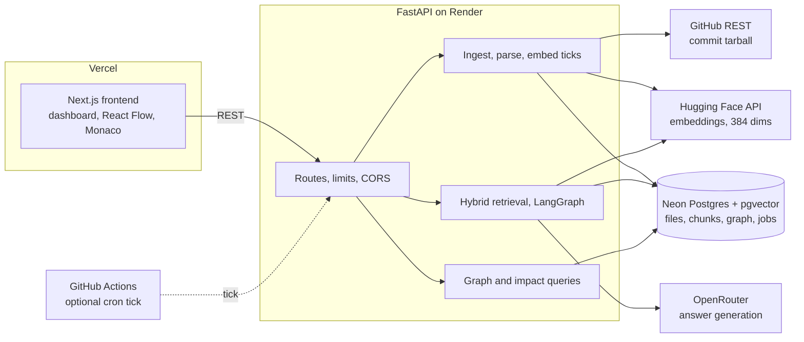
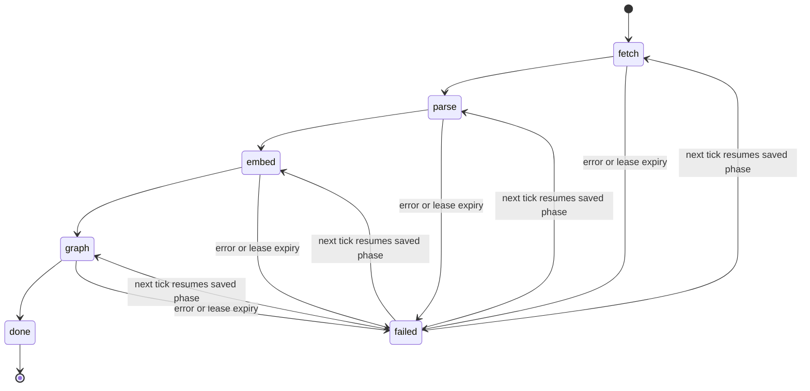
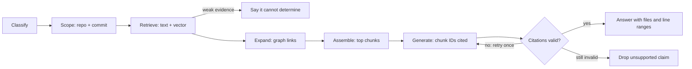

# Architecture

The API keeps no state between requests. The browser, or an optional cron, calls `tick`; each tick does one bounded step, and every result is written to Postgres, so a sleeping Render instance loses nothing.

## System overview



Backend modules depend inward only: routes call services, services call repositories and providers, nothing imports routes.

## Indexing job lifecycle



Each tick claims the job with `SELECT ... FOR UPDATE SKIP LOCKED`, runs one bounded step (about 20 s) of the current phase, and saves the phase and cursor. A dead tick's lease expires and the next tick continues from the saved state.

## Chat workflow (LangGraph)



The model returns chunk IDs, never line numbers. The server maps IDs to path and line range and rejects any ID that was not retrieved.

## Database schema

File contents live in Postgres because Render's disk is ephemeral and a resumed job must not re-download the repo.

| Table | Key columns | Purpose |
| --- | --- | --- |
| `repositories` | id, owner, name, url, default_branch, created_at | One row per GitHub repo. Unique on (owner, name). |
| `snapshots` | id, repo_id, commit_sha, status, file_count, chunk_count, error, indexed_at | One per pinned commit. Unique on (repo_id, commit_sha), which blocks duplicate ingestion. |
| `index_jobs` | id, snapshot_id, phase, cursor (jsonb), lease_until, attempts, error | Resumable state machine. Phases: fetch, parse, embed, graph, done, failed. |
| `files` | id, snapshot_id, path, language, size_bytes, sha256, content, skipped_reason | Source text, capped per file. Secrets redacted before insert. |
| `symbols` | id, snapshot_id, file_id, kind, name, qualified_name, start_line, end_line | Functions, classes, methods, modules. |
| `chunks` | id, snapshot_id, file_id, symbol_id, start_line, end_line, text, tsv, embedding vector(384), embedding_model | Syntax-aware chunks. `tsv` is a generated tsvector. |
| `graph_edges` | id, snapshot_id, src_symbol_id, dst_symbol_id, src_file_id, dst_file_id, kind, resolution | kind: imports, calls, contains. resolution: static or unresolved. Unresolved calls are stored but never drawn as facts. |
| `chat_usage` | id, repo_id, client_key, day, count | Per-client quotas for chat and impact calls. |

**Indexes**
- GIN on `chunks.tsv` for keyword search.
- HNSW on `chunks.embedding` with cosine ops, created after bulk insert.
- B-tree on `(snapshot_id, path)` for files, and on `(snapshot_id, src_symbol_id)` and `(snapshot_id, dst_symbol_id)` for edges.

**Notes**
- Every row carries `snapshot_id`, so answers are scoped to one commit and old snapshots can be deleted whole.
- `embedding_model` is stored per chunk. A repo never mixes models; changing the model means a re-index.
- Alembic migrations use Neon's direct (non-pooled) URL. The app uses the pooled URL with a pool of about 3.
- Neon's 0.5 GB limit: 5,000 chunks at 384 dims is roughly 8 MB of vectors, so the quota is about text size, not vectors.

## API contracts

OpenAPI is served at `/docs`. All bodies are Pydantic models.

| Method and path | Request | Response |
| --- | --- | --- |
| `POST /api/repositories` | `{url}` | 201 repository (validated, owner and name parsed, no fetch yet) |
| `GET /api/repositories` | paging params | list of repositories with latest snapshot summary |
| `GET /api/repositories/{id}` | none | repository, snapshots, stats (files, symbols, chunks, languages) |
| `POST /api/repositories/{id}/index` | optional `{ref}` | 202 snapshot and job. Returns the existing snapshot if that commit is already indexed. |
| `POST /api/repositories/{id}/index/tick` | none | job after one bounded step (about 20 s budget). Safe to call repeatedly. |
| `GET /api/repositories/{id}/status` | none | phase, progress counts, error, `can_resume` |
| `GET /api/repositories/{id}/graph` | `level` (file or symbol), `focus`, `depth` | nodes and edges, each edge tagged `static` or `unresolved` |
| `GET /api/repositories/{id}/files/{path}` | `snapshot` | file content, language, symbols (for Monaco and the explorer) |
| `POST /api/repositories/{id}/chat` | `{question, history?}` | answer, citations `[{path, start_line, end_line, chunk_id}]`, `confidence`, `insufficient_evidence` |
| `POST /api/repositories/{id}/impact` | `{target: {file or symbol}}` | direct dependents, transitive dependents, affected modules, suggested tests, confidence, limitations |
| `GET /health`, `GET /ready` | none | liveness, and readiness (DB reachable, migrations at head) |

**Error envelope** (every non-2xx):

```json
{"error": {"code": "invalid_github_url", "message": "...", "details": {}, "request_id": "..."}}
```

Codes: `invalid_github_url`, `repo_not_found`, `repo_too_large`, `rate_limited`, `quota_exceeded`, `job_in_progress`, `snapshot_not_ready`, `llm_unavailable`, `validation_error`.

**Result shapes that matter**
- A citation always comes from a retrieved chunk. The server maps chunk IDs to path and lines.
- The impact response splits `static` (from graph edges, with the edge path) and `ai_suggestions` (labeled, no edges invented). `limitations` names unresolved calls near the target.
- Rate limits are per-IP on all routes, tighter on chat and impact, returned as `429` with `Retry-After`.

## Repository structure

```text
codebase-intelligence/
  backend/
    app/
      main.py              # app factory, CORS, middleware, routers
      core/                # config, logging, errors, rate limiting
      db/                  # engine, session, models
      schemas/             # Pydantic request and response models
      api/                 # routers: repositories, index, graph, chat, impact, health
      services/
        github/            # URL validation, tarball fetch, filtering
        indexing/          # job state machine, tick runner
        parsing/           # Tree-sitter adapters per language, chunker
        security/          # secret scanner, redaction
        graph/             # edge building, resolution, queries
        retrieval/         # keyword, vector, RRF fusion, graph expansion
        qa/                # LangGraph workflow, prompts, citation validator
        impact/            # static traversal plus AI suggestion step
      providers/
        llm/               # OpenRouter client, stub
        embeddings/        # Hugging Face client, hash embedder
    alembic/               # migrations
    tests/                 # unit, integration, fixtures
    eval/                  # labeled dataset, run_eval.py, results/
    Dockerfile  pyproject.toml
  frontend/
    src/app/               # Next.js routes
    src/components/        # explorer, graph, chat, impact, stats
    src/lib/               # typed API client, TanStack Query hooks
    Dockerfile  package.json  vercel.json
  docs/                    # architecture, plan, ADRs, demo script
  .github/workflows/ci.yml
  docker-compose.yml  render.yaml  .env.example  README.md
```

## Key trade-offs

| Decision | Chosen | Alternative | Why |
| --- | --- | --- | --- |
| Job execution | Tick endpoint driven by the browser, optional GitHub Actions cron | Celery or RQ worker | A worker needs an always-on process, which Render free does not give. State in Postgres survives sleeps. |
| Repo fetch | One tarball per commit SHA | Per-file contents API | About 2 API calls instead of hundreds, so the GitHub rate limit is rarely a factor. |
| File storage | Postgres `files.content` | Render disk or S3 | Disk is ephemeral. A resumed job reads from the DB. |
| Call graph | Static edges only, `unresolved` flagged | Guess dynamic calls | Wrong edges destroy trust in impact analysis. |
| Citations | Model returns chunk IDs, server maps to lines | Model types line numbers | Open models misquote lines. IDs can be checked mechanically. |
| Retrieval | Full-text plus vector, RRF fusion | Vector only | Code queries contain exact identifiers that embeddings blur. The benchmark tests this claim. |
| Vector size | 384 dims | 1024+ dims | Fits Neon's 0.5 GB and HF's small models. |
| Connections | Neon pooled URL, pool of about 3, pre-ping | Large pool | Neon limits connections, and the compute suspends when idle. |

## Security model

- **Never execute repo code:** files are only read as text and parsed. No installs, no imports, no shell on repo contents.
- **Prompt injection:** repo text goes into the prompt inside delimited untrusted blocks. The model has no tools. Citations are validated server-side, so injected text cannot invent a source.
- **Secrets:** skip `.env` and key files, scan content with patterns, and redact or drop matching chunks before storing. Never log content.
- **Limits:** max tarball size, max file size, max files and chunks per repo, ingestion quota per client per day, chat quota per client.
- **Network:** explicit CORS allow-list, per-IP rate limiting, API keys only in env vars and never sent to the browser.
- **SSRF:** only github.com URLs of the form owner/name are accepted.
