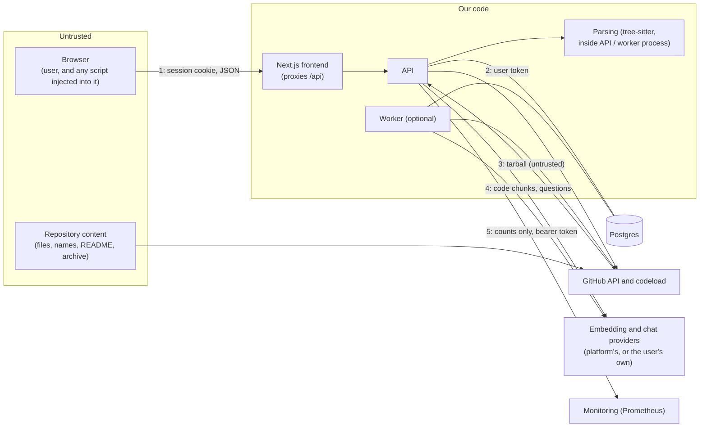

# Threat model and security review

Reviewed: 2026-11-18, against the code as it stands (M1 to M9 and the first M10 pieces).

**What this is, and is not.** A structured review by the people who built the system, written by walking each trust boundary and asking what an attacker could do, then checking each claimed defence against the code and its tests. It is **not** an independent review and **not** a penetration test: nobody tried to break the running system from outside, and nothing here was checked by a third party. Treat the "mitigated" column as "a defence exists and a test pins it", not "cannot happen". The most important part is [Open risks](#open-risks): the things that are not solved.

## What is protected

| Asset | Why it matters | Where it lives |
| --- | --- | --- |
| Private source code | The most sensitive thing the app holds. Leaking it is the worst outcome. | `files.content`, `chunks.text` and their embeddings, in Postgres (not encrypted by the app) |
| Users' provider keys | Spend and access on their accounts | `user_providers.key_enc` (Fernet) or only the browser tab |
| Users' GitHub tokens | Read access to their repositories | `github_credentials` (Fernet, refreshed) |
| Sessions | Acting as a user | `user_sessions` (token stored as a SHA-256 hash), HttpOnly cookie |
| The platform's provider keys and free-tier quotas | Cost, and availability for everyone | Server environment |
| Public repository index | Low sensitivity (it is public), but integrity matters: wrong data means wrong answers | Postgres |
| The audit log | Evidence of who used what | `audit_events` |

## Who might attack, and from where

| Actor | Capability assumed |
| --- | --- |
| Anonymous visitor | Reaches the frontend and any unauthenticated API route |
| Signed-in user (hostile) | Has an account, can connect repositories, can call every route with their own session |
| Another tenant | As above, trying to reach someone else's private repository |
| Repository author | Controls the content of a repository someone indexes: filenames, source, README, archive structure |
| A compromised or curious third party | A provider (embedding, chat), GitHub, or the hosting platform |
| The operator or an insider | Can read the database and the environment |
| The supply chain | Malicious or vulnerable dependency, base image, CI action |

Out of scope: physical access, a compromised developer machine, attacks on GitHub, Cloudflare, OpenRouter, Neon, Render or Vercel themselves beyond what their own contracts cover.

## Data flow and trust boundaries

1. **Browser to API.** Cookie sessions, same-origin through the frontend's proxy.
2. **API to GitHub.** The user's own token, sent only to the API host.
3. **GitHub to API.** The archive is untrusted input: every byte, name and size.
4. **API to providers.** Code and questions leave the system here. For a private repository only to the owner's own provider.
5. **API to monitoring.** Counts and timings under fixed labels.

## Threats and what answers them

Status: **Mitigated** (a defence exists and a test pins it), **Partly** (a defence exists with a stated gap), **Open** (see Open risks).

### Identity and sessions

| # | Threat | Defence, and where to check it | Status |
| --- | --- | --- | --- |
| A1 | Login CSRF, or a forged callback | OAuth with `state` and PKCE; the state travels in a sealed, short-lived, HttpOnly cookie. `test_callback_without_state_cookie_is_rejected`, `test_callback_with_tampered_state_cookie_is_rejected` | Mitigated |
| A2 | Open redirect after login | `safe_next` accepts only same-site paths. `test_safe_next_blocks_open_redirects`, `test_next_parameter_cannot_redirect_off_site` | Mitigated |
| A3 | Stealing a session from the database | Only a SHA-256 hash of the random 32-byte token is stored; absolute and idle expiry | Mitigated |
| A4 | Stealing a session in the browser | HttpOnly and SameSite=Lax cookie, Secure and `__Host-` in production (production refuses to start without `COOKIE_SECURE`). A per-request-nonce Content-Security-Policy stops an injected script from running at all (O1) | Mitigated |
| A5 | Cross-site request forgery on state-changing routes | SameSite=Lax plus an Origin check on every non-safe method (`csrf_guard`). `test_disconnect_needs_sign_in_and_a_same_origin_request`, `test_sign_in_and_same_origin_are_required` | Mitigated |
| A6 | Stolen GitHub or provider tokens at rest | Fernet encryption with `TOKEN_ENCRYPTION_KEY`; only the last four characters of a provider key are ever shown. The key sits in the same environment as the data (no KMS) | Partly (O3) |

### Tenancy

| # | Threat | Defence | Status |
| --- | --- | --- | --- |
| T1 | A user reads or changes another user's repository | One ownership dependency (`OwnedRepo`) on every repository route; a missing or foreign id is a 404 (ids cannot be probed). `test_another_users_repository_is_a_404_on_every_route`, `test_every_route_treats_another_users_private_repository_as_missing` (13 routes, both methods) | Mitigated |
| T2 | A private repository is shared or deduplicated | Private rows belong to one user; the unique index is per owner; a check constraint ties `is_private` to an owner. `test_two_users_with_access_get_separate_private_rows`, `test_database_rules_for_private_rows` | Mitigated |
| T3 | A client claims a repository is public (or private) | Visibility is read from GitHub with the caller's own token, never from the request. `test_the_client_cannot_claim_a_repository_is_public_or_private` | Mitigated |
| T4 | Someone connects a private repository by name | GitHub, asked with their token, does not show it (404). `test_someone_without_access_cannot_reach_a_private_repository_by_connecting_its_name` | Mitigated |
| T5 | Revoked access keeps working | GitHub is asked again at most every `PRIVATE_ACCESS_RECHECK_SECONDS` (300); failure is closed; the owner can still disconnect. `test_revoked_access_stops_every_route_but_still_allows_disconnecting`, `test_access_that_cannot_be_confirmed_fails_closed` | Partly (the window) |
| T6 | A bug in one route leaks across tenants | Defence in depth is **not** built: no row-level security, one database role for the whole app | Open (O4) |
| T7 | A repository turns private after being indexed as public | Public rows are not rechecked; data already indexed stays visible to those connected | Open (O9) |

### Hostile repository content

| # | Threat | Defence | Status |
| --- | --- | --- | --- |
| R1 | Archive attacks (path traversal, symlinks, huge or many entries, decompression bombs) | Streaming read, nothing written to disk; paths validated; only regular files; caps on compressed size, declared uncompressed size, entry count, file size, kept files and bytes; wall-clock deadline. `test_tarball_with_hostile_members_cannot_escape`, `test_unsafe_paths_are_skipped`, `test_uncompressed_size_cap_uses_declared_sizes` | Mitigated |
| R2 | Secrets committed to the repository end up stored and shown | Credential-like values are replaced before anything is stored, line numbers preserved (`test_redaction_keeps_symbols_and_line_numbers_aligned_with_the_original_file`). It is heuristic: a secret that does not look like one is stored | Partly |
| R3 | A file crafted to crash or hang the parser | Per-file size cap, parse timeout, partial results on errors; parsing runs inside the API or worker process, with no sandbox | Partly (O2) |
| R4 | Prompt injection: repository text tells the model what to say | Retrieved code is framed by a per-request random nonce and the question stays outside it; the model has no tools; every claim must quote retrieved code word for word or it is dropped, so injected text cannot become a cited fact. `test_a_model_that_obeys_injected_instructions_is_not_believed` | Mitigated for what is cited; see O11 |
| R5 | Repository text becomes script in the browser | Code and answers are rendered as text by React and the Monaco editor; there is no `dangerouslySetInnerHTML`, `innerHTML` or `eval` in the frontend (checked by search in this review). If a sink were ever introduced, the CSP (O1) would still stop the script | Mitigated |
| R6 | SQL or full-text query injection through search | Every request value is a bound parameter; the one f-string SQL splices only module constants (flagged by the scanner, reviewed, annotated); query text is sanitised before `to_tsquery`. `test_no_input_can_inject_tsquery_syntax`, `test_hostile_queries_are_safe` | Mitigated |

### Outbound requests and third parties

| # | Threat | Defence | Status |
| --- | --- | --- | --- |
| S1 | A user-supplied provider points the server at an internal address (SSRF) | Users choose a provider from a fixed catalogue and never type a URL; the address must be https, on the catalogue's host list, no credentials or odd port, and resolve only to public addresses; redirects are never followed. `test_ssrf.py` (look-alike hosts, the `user@host` trick, IP literals, internal resolution, failed lookups) and `test_a_provider_address_that_resolves_internally_is_refused_before_any_call` | Mitigated |
| S2 | GitHub is made to redirect a download somewhere else, or the token is sent there | The token goes only to the API host; the archive redirect must be https on `codeload.github.com` and is fetched without credentials. `test_tarball_redirect_to_unexpected_host_is_refused` | Mitigated |
| S3 | Private code reaches the platform's providers | Routes get providers from one resolver: a private repository only ever uses its owner's, and the embed step refuses to run without them even if a caller forgets. Tests run the whole flow with the platform's providers wired up but forbidden (`test_private_providers.py`, `test_worker.py`) | Mitigated |
| S4 | Private code or keys in logs, metrics or the audit log | Logs, metrics and audit rows hold names, ids, counts and timings only; `test_log_hygiene.py` searches every log record for planted markers across success and failure paths, `test_metrics_hold_no_names_ids_questions_or_keys` does the same for metrics, `audit.record` rejects long or non-scalar values. It shows today's paths are clean, not that future code will be | Mitigated, needs vigilance |
| S5 | What a provider does with the data once it has it | Cannot be controlled here; the privacy notice says so and tells users to check the provider's terms | Accepted |

### Availability and abuse

| # | Threat | Defence | Status |
| --- | --- | --- | --- |
| D1 | Flooding the API | Per-IP and per-user sliding-window limits (`test_ratelimit.py`), `X-Forwarded-For` trusted only behind a configured number of proxies, separate limits for search, AI calls and questions. The limiter lives in the process: one instance only | Partly (O5) |
| D2 | One user burns the shared free-tier quotas (embedding, chat) | Per-user indexing and question limits (`test_quota_is_per_user`); there is **no global budget**, so several users together can still exhaust the platform's allowance | Open (O5) |
| D3 | A job or request that never finishes | Leases and bounded steps, a wall-clock budget on model calls, retries with backoff and a terminal failure state | Mitigated |
| D4 | The metrics or maintenance endpoints are abused | Both need a bearer token (constant-time compare), do not exist without one, and are per-IP limited. `test_the_purge_endpoint_needs_the_right_token_and_no_session`, `test_the_endpoint_needs_the_token_and_no_session` | Mitigated |

### Operator, supply chain and deployment

| # | Threat | Defence | Status |
| --- | --- | --- | --- |
| O-a | Someone with database access reads private code | Not defended: the source text is stored in clear (disk encryption by the database host only). Retention and deletion limit how long it exists; backups are outside the app | Open (O3) |
| O-b | Vulnerable or malicious dependency | Lock files; weekly and per-change scanning of Python and npm dependencies, the container image and the repository history (this review added them; see below); Dependabot update PRs | Mitigated, see O8 |
| O-c | A vulnerable container image | Non-root user, no `pip` in the image, OS packages upgraded at build, image scanned in CI; unfixed OS findings remain (below) | Partly |
| O-d | A weak production configuration | In production the API refuses to start without the auth settings, `COOKIE_SECURE`, an https base URL and a non-default salt | Mitigated |

## Open risks

In rough order of how much they matter. O1 is now largely addressed (its remaining gaps are listed); the others are not solved.

1. **O1. Content-Security-Policy: built, with stated gaps.** Every page request gets its own random nonce and a policy that lets only nonce-carrying scripts (and what they load) run: no `'unsafe-inline'`, no `'unsafe-eval'` in production, `connect-src 'self'`, no foreign frames, `object-src 'none'`, `base-uri 'self'`, `frame-ancestors 'none'`, and upgrade of insecure requests when the request was https (`frontend/src/proxy.ts`, `frontend/src/lib/csp.ts`, 20 unit tests). It was checked in a real browser against the real built app: normal use of every page, including indexing, the Monaco editor and the React Flow graph, produced no violations and no errors, and injected markup (an inline script, a foreign script, an event handler, `eval` from a trusted script, a cross-origin `fetch`, a foreign frame, a `<base>` tag) was blocked. That browser check was run by hand and is **not automated in CI**; the unit tests pin the policy's text, not the browser's behaviour. Remaining gaps: (a) `style-src` allows `'unsafe-inline'`, because Monaco and React Flow create styles at run time, so injected CSS is possible (far less dangerous than script, but not nothing); (b) `'strict-dynamic'` trusts scripts created by an already trusted script, so a gadget that turns attacker text into a new script element would pass; (c) nothing collects violation reports, so a policy that breaks in some browser would be noticed by users, not by us (`CSP_MODE=report-only` exists to roll a change out safely); (d) every page now renders per request, because a nonce cannot exist in a prerendered page (a hosting cost and a little latency, not a security gap); (e) API responses carry no CSP of their own (they are JSON). Also added: `Permissions-Policy` and `Cross-Origin-Opener-Policy`.
2. **O2. Parsing runs unsandboxed, in the same process as the API (or worker).** Tree-sitter is native code reading hostile files. Size caps and a timeout limit the damage from a hang, not from a memory-safety bug in a grammar, which could take the process down or worse. The planned fix (a separate, resource-limited, network-less worker) is not built.
3. **O3. Private code is stored in clear in the database, and the encryption key sits beside it.** Anyone who can read the database can read private repositories; anyone who can read the environment can also decrypt stored keys. Embeddings leak some of the content too. Retention (30 days by default) and deletion shorten the exposure; database backups are not covered. Envelope encryption with a key service, and moving source text out of the database, are not built.
4. **O4. No row-level security.** Tenant isolation rests on one dependency and the discipline to use it on every new route; a mistake would leak across tenants. The 13-route test would catch a missing check on an existing route but not on a route nobody added to the list.
5. **O5. Availability controls are single-instance and have no global budget.** The rate limiter is in memory, so a second API instance would double every limit; and there is no cap across all users on the platform's free provider quotas. Redis-backed limits were deliberately postponed.
6. **O6. A browser-held key lives in `sessionStorage`.** Readable by any script on the page (see O1) and by browser extensions. The alternative, a stored key, is exposed to O3.
7. **O7. The audit log is not tamper-proof.** Whoever can write to the database can alter it. It is a record for the user and the operator, not evidence against a hostile operator.
8. **O8. Supply-chain gaps.** GitHub Actions are referenced by version tag, not commit hash; the scanner images (`trivy`, `gitleaks`) are pulled as `latest` so their rules stay fresh, which also means they are not reproducible; there is no software bill of materials and no signing of the image.
9. **O9. A repository that goes from public to private is not noticed** for people already connected, so data indexed while it was public stays readable by them.
10. **O10. Revocation takes up to five minutes** for a private repository (the recheck window).
11. **O11. Answers can still mislead.** The validator proves a cited quote exists in the cited lines, not that the claim follows from it; retrieval can miss the relevant code and the model can answer confidently from the wrong excerpts. This is a correctness risk more than a security one, but injected text could try to steer an answer's emphasis.
12. **O12. Monitoring is untested in production.** The alert rules are unit-tested and a local scrape worked, but no alert has ever been delivered, the thresholds are untuned guesses, and there is no tracing.

## What the scanners found in this review

Run on 2026-11-18. They are now part of CI (`.github/workflows/security.yml`, weekly as well as on every change, because new advisories appear without any code change).

| Scanner | Looks at | Result | Action |
| --- | --- | --- | --- |
| `pip-audit` | Locked Python dependencies | No known vulnerabilities | Gate in CI |
| `bandit` | Python application code | 14 findings: 11 `assert` (skipped by policy: they only narrow types for mypy), 1 empty-string "password" placeholder, 1 swallowed `close()` error, 1 SQL f-string | Placeholder annotated, the swallowed error now logged, the SQL reviewed (only module constants are spliced; every value is bound) and annotated. A planted injection is caught. Zero findings now; gate in CI |
| `npm audit` (production) | What ships to browsers | 0 vulnerabilities | Gate in CI |
| `npm audit` (all) | Plus development tools | 17 high, **all one advisory**: `picomatch` ReDoS (`GHSA-fc5q-39xc-vjpf`). No patched version exists (4.0.7 is latest and affected); npm's suggested "fix" is a downgrade of the test runner | Accepted explicitly in `frontend/scripts/audit-policy.mjs` with a reason and an expiry (2026-12-31); the build fails after that date, or on any other high advisory (tested) |
| `trivy` (image) | OS packages and Python packages in the API image | **6 fixable high findings**: a `zlib` update, and `urllib3`, `msgpack` and `setuptools` found *inside pip's vendored copies* in the base image (the app's own `urllib3` was already current) | Dockerfile now upgrades OS packages and removes `pip` (the app never runs it). Rescan: 0 fixable high or critical. A vulnerable base image fails the gate (checked). **Not fixed because no fix exists:** 46 high-severity findings in the base image's operating-system packages marked "affected" (no fixed version published) and 1 whose fix is deferred; none is in the app's own Python packages. They are not actionable, so they are watched, not gated |
| `trivy` (config) | Dockerfile, compose, workflows | Clean at medium and above | Gate in CI |
| `gitleaks` | All 11 commits | 2 hits, both synthetic test fixtures (a random-bodied fake key block, and the documented example token format) | Allowlisted narrowly, by file and rule, in `.gitleaks.toml`; a planted real-looking secret elsewhere still fails (checked) |

What scanners cannot see: logic flaws (a missing ownership check), authorisation bugs, anything that needs running the system as an attacker, and vulnerabilities nobody has reported yet.

## Keeping this current

Re-read the relevant section when any of these change, and update the tests it names:

- **A new route that touches a repository:** it must use `OwnedRepo`, and be added to the wrong-user route list in `test_private_repos.py`.
- **A new provider, or a new outbound call:** it must come from the catalogue and pass the address guard.
- **A new log line, metric label or audit field:** nothing derived from content, names, questions or keys.
- **A new stored secret or kind of private data:** how is it encrypted, retained and deleted?
- **A new third party that sees user data:** add it to the data flow and to the privacy notice.

When a scan fails, fix it, or add an exception that carries a reason and an expiry date. Do not weaken the gate.
